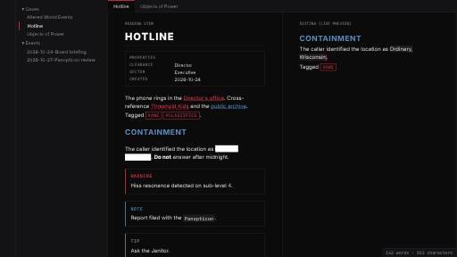
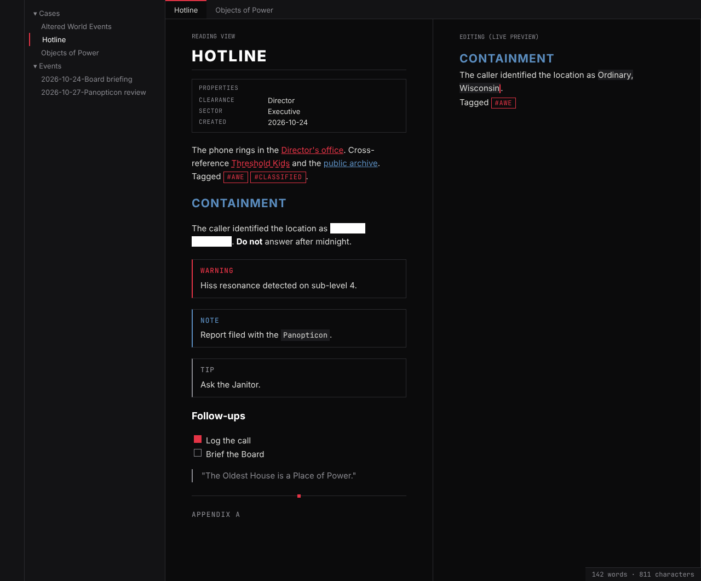
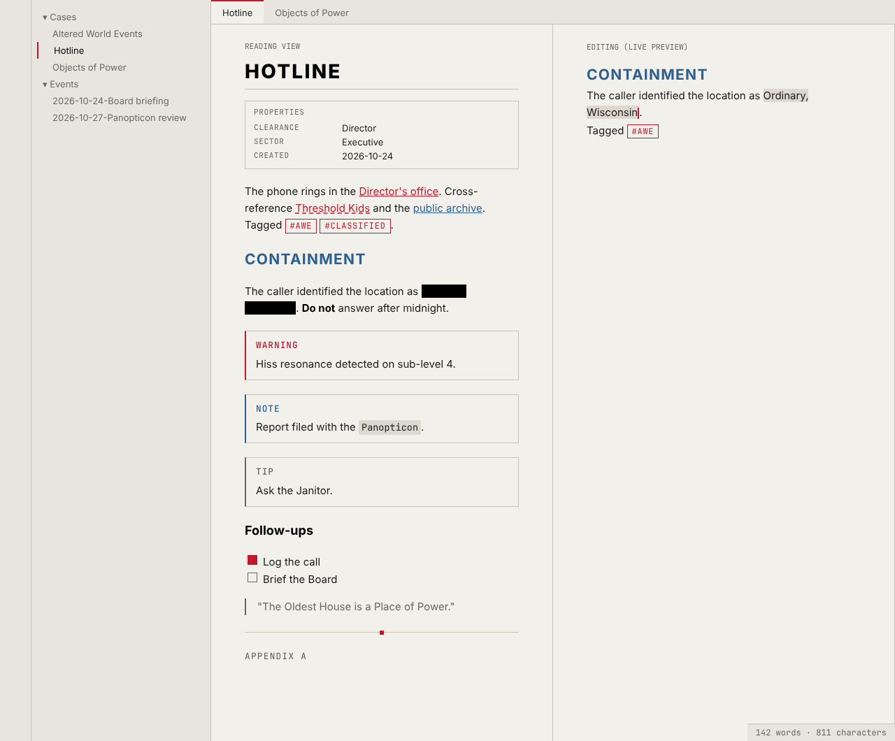

# Bureau

A minimal Obsidian theme inspired by the Federal Bureau of Control: brutalist, typographic,
restrained. Concrete greys, title-card headings, hairline rules, square corners, no glow.



| Dark: the Oldest House | Light: paper |
|---|---|
|  |  |

## The colour rule

Mostly black and white, with two accents that each have one job:

- **Red points inside your vault:** internal links, tags, the cursor, the active file and tab, checkboxes.
- **Blue points outside it:** web links. Blue is also used for H2 headings.

Neither accent is used as a large fill. Unresolved links are red with a dashed underline.
Callouts are remapped to the palette: `note`/`info` blue, warnings and errors red, everything else grey.

## Details

- **Headings:** H1 and the note title are uppercase title cards; H2 is uppercase and blue;
  H4–H6 are small monospace labels.
- **Properties** read as a case-file header; **tags** as classification stamps;
  **callouts** as memos.
- **Highlights are redactions.** `==text==` shows as a solid bar in reading view and is revealed
  on hover (or tap on mobile). While you edit, highlights stay readable. Printing and PDF export
  show highlights underlined instead of redacted.
- Fonts: Inter, then Helvetica Neue / Arial; JetBrains Mono or IBM Plex Mono for metadata. Nothing
  is bundled; install the fonts you like or override them in Settings → Appearance.

## Install

- **Manually:** create `.obsidian/themes/Bureau/` in your vault, put `theme.css` and
  `manifest.json` from the latest release in it, then pick **Bureau** in Settings → Appearance → Themes.
- **With BRAT:** "Add a beta theme" → `bobafouette/obsidian-bureau-theme`.

## Development

No build, no dependencies, Node 22.

```sh
node --test 'test/*.test.js'   # palette, contrast, structure and detail rules of theme.css
node scripts/check.js          # theme.css well formed and self-contained, manifest valid
node scripts/screenshot.js     # re-render preview/*.png and screenshot.png (needs Playwright)
```

`preview/sample.html` is a mock of Obsidian's DOM (with `preview/obsidian-base.css` standing in
for the app's own CSS); open it in a browser with `?mode=dark` or `?mode=light`.

## Release

Tag `X.Y.Z` (no `v`) and push the tag, or publish a release from the GitHub page.
`release.yml` writes the tag into `manifest.json`, runs the checks and tests, and attaches
`theme.css` and `manifest.json` to the release. `node scripts/bump-version.js X.Y.Z` does the
same bump locally if you want the version committed first.

## Status

Not yet tested inside real Obsidian; the preview is a mock. Please report anything that looks off.
